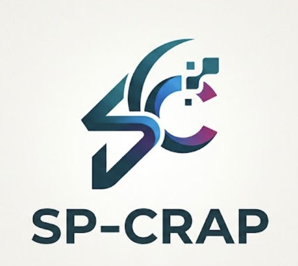

<p align="center">
  
</p>

# sp-crap-check

Zero-dependency PHP CLI to gate PHPUnit **crap4j** reports on CRAP score, with JSON config and ignore rules.

**Requirements:** PHP 8.3+ (8.5 compatible), `ext-simplexml`

## What is CRAP?

**CRAP** (Change Risk Anti-Patterns) is a per-method score that combines **cyclomatic complexity** (how many branches and paths exist) with **line coverage** from your tests. Intuitively: a method that is hard to follow and rarely executed by tests is expensive and risky to change.

PHPUnit’s crap4j report uses a formula in this family (per method *m*, complexity `comp`, coverage percent `cov`):

```
CRAP(m) = comp(m)² × (1 - cov(m)/100)³ + comp(m)
```

Simple or well-covered methods stay near **1**. Scores climb when complexity grows and coverage drops—exactly the methods where regressions hide and refactors hurt.

### Why use it with AI-assisted development?

Agents and copilots can add features quickly: new branches, edge cases, and “just one more” helper in an already dense method. Unit tests and static analysis often still pass while **change risk** piles up method by method. A green build does not mean the next prompt-driven edit is safe.

Running `sp-crap-check` after coverage gives you a cheap, objective gate:

- Surfaces **untested complex code** before merge, not after production surprises.
- Works at **method granularity**, where agents tend to edit, not only at file or project coverage %.
- **`max_violations`** lets legacy debt coexist with a ratchet: new hot spots must be fixed or traded for old ones.

CRAP is a signal for review and testing focus, not a moral score. Use it to decide where humans (or agents) should add tests or simplify logic—not to chase a number with meaningless assertions.

### Why this saves tokens for AI agents

A crap4j XML file (or an HTML coverage report) is large. Pasting it into a prompt, or asking the model to re-read every method and guess which ones are risky, spends context on data the agent does not need.

`sp-crap-check` does that filtering outside the model. The agent only receives:

- an **exit code** (pass, over budget, or a setup error), and
- a **short list** of methods that actually exceed the threshold — class, method, CRAP score — or nothing extra when the gate passes.

`--format=json` and `-q` keep that payload machine-readable and free of banners. The agent spends tokens on the few methods worth a test or a split, and leaves the rest of the report on disk.

It combines with tools you already run. **PHPUnit** (with PCOV or Xdebug) writes the crap4j file; `sp-crap-check` only reads that file and applies the threshold. No second test runner, no extra coverage format, and no change to how tests are written.

## Install with Composer

Project dependency (typical for CI):

```bash
composer require --dev stefpe/sp-crap
vendor/bin/sp-crap-check check var/coverage/crap4j.xml --threshold=30
```

Global binary:

```bash
composer global require stefpe/sp-crap
~/.composer/vendor/bin/sp-crap-check --version
```

Ensure Composer’s global `vendor/bin` is on your `PATH`.

Install from GitHub before [Packagist](https://packagist.org) (if needed):

```bash
composer require --dev stefpe/sp-crap:^1.1
```

Composer resolves `stefpe/sp-crap` from GitHub automatically once the package is public.

## Install from release (PHAR)

```bash
curl -fsSL https://github.com/stefpe/sp-crap/releases/latest/download/sp-crap-check.phar \
  -o /usr/local/bin/sp-crap-check
chmod +x /usr/local/bin/sp-crap-check
```

Or download the `.zip` asset, extract, and run `php sp-crap-check` from the folder.

## PHPUnit setup (required first)

`sp-crap-check` only **reads** a Crap4J XML file. It does not run tests or compute coverage. You must configure **PHPUnit** to emit crap4j on every run where you gate CRAP (local, CI, or agent workflows).

**1. Coverage driver** — PHPUnit needs **PCOV** or **Xdebug** with coverage enabled, for example:

```bash
php -d pcov.enabled=1 vendor/bin/phpunit …
```

**DDEV:** PCOV is not in the default web image. Add the package for your PHP version in `.ddev/config.yaml`, then rebuild:

```yaml
webimage_extra_packages: [php8.5-pcov]
```

Use `php8.4-pcov`, `php8.5-pcov`, etc. to match `php_version` in the same file. Apply the change with `ddev restart` (or `ddev debug rebuild` if the extension does not show up). Inside the container, run PHPUnit with `php -d pcov.enabled=1 …` as above.

**2. Crap4J output** — either add it to `phpunit.xml` / `phpunit.xml.dist`:

```xml
<phpunit …>
    <coverage>
        <report>
            <crap4j outputFile="var/coverage/crap4j.xml" threshold="30"/>
        </report>
    </coverage>
</phpunit>
```

(`threshold` on the element is for PHPUnit’s stats in the XML; `sp-crap-check` uses its own `--threshold` / config.)

**Or** pass the path on the command line (no XML change):

```bash
php -d pcov.enabled=1 vendor/bin/phpunit --coverage-crap4j var/coverage/crap4j.xml
```

Use the **same path** in `sp-crap-check` or in `.crap-checker.json` → `"report"`. Run `sp-crap-check doctor` to confirm PHPUnit config and report path.

**Typical pipeline:**

```text
PHPUnit (with PCOV/Xdebug) → writes var/coverage/crap4j.xml → sp-crap-check check …
```

## Usage

After PHPUnit has produced crap4j:

```bash
php -d pcov.enabled=1 vendor/bin/phpunit --coverage-crap4j var/coverage/crap4j.xml

sp-crap-check check var/coverage/crap4j.xml --threshold=30 --max-violations=111 -v
```

With a project config file `.crap-checker.json` (see `.crap-checker.json.example`):

```bash
sp-crap-check check -v
sp-crap-check doctor
```

### CRAP scope: all methods (default)

Uncle Bob’s **CRAP** score applies to **every** function and method PHPUnit measures—`public`, `protected`, `private`, and package-private alike. **SP-CRAP follows that by default:** every entry in the crap4j report is eligible for the threshold.

Optional filter if you only want to gate your **public API** (e.g. fewer CI violations when private helpers are complex but covered indirectly):

```bash
sp-crap-check check --public-only
```

Or in JSON: `"public_methods_only": true` (uses reflection after loading `vendor/autoload.php`). `-v` reports how many non-public methods were skipped.

### Config (JSON)

| Key | Description |
|-----|-------------|
| `report` | Default path to crap4j.xml |
| `threshold` | Max CRAP per method (default `30`) |
| `max_violations` | Ratchet: allow N methods over threshold |
| `public_methods_only` | Only check public methods (default `false`) |
| `ignore_files` / `ignore_coverage_files` | Path globs |
| `ignore_classes` | FQCN globs (`App\\Legacy\\*`) |
| `ignore_methods` | `Class::method`, `Class::*`, or method name |

CLI flags override config. `--config=/path/to.json` selects a file; otherwise `.crap-checker.json` is searched upward from the current directory.

## Exit codes

| Code | Meaning |
|-----:|---------|
| 0 | OK |
| 1 | Threshold / violation budget exceeded |
| 2 | Invalid input |
| 3 | Report not found |
| 4 | Invalid XML |
| 5 | No methods |
| 6 | Stale report (`--max-age`) |

## Development

```bash
composer install
composer exec sp-crap-check check path/to/crap4j.xml --threshold=30
php -d phar.readonly=0 tools/build-phar.php
```
